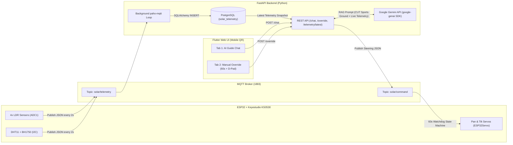

# Central University of Technology (CUT) — Smart Solar Tracking System

Full-stack IoT software stack for the **Central University of Technology (CUT)** smart solar tracking demonstration unit. The system pairs an **ESP32-driven Keyestudio KS0530 Dual-Axis Solar Tracking Kit** with an **MQTT telemetry pipeline**, a **FastAPI + PostgreSQL + Google Gemini (`google-genai`) backend**, and a **mobile-first Flutter Web UI** accessed via QR code.

---

## 1. System Architecture



---

## 2. Monorepo Directory Structure

```text
CUT-solar-tracker/
├── backend/
│   ├── .env.example          # Environment variable template
│   ├── database.py           # SQLAlchemy PostgreSQL engine & session factory
│   ├── main.py               # FastAPI server, lifespan MQTT loop, /chat & /override
│   ├── models.py             # SQLAlchemy SolarTelemetry table & TrackerMode enum
│   ├── mqtt_client.py        # Background paho-mqtt subscriber & command publisher
│   ├── requirements.txt      # Python dependencies
│   └── schemas.py            # Pydantic v2 request/response validation schemas
├── frontend/
│   ├── pubspec.yaml          # Flutter Web dependencies
│   ├── web/
│   │   └── index.html        # Mobile viewport configuration
│   └── lib/
│       ├── main.dart         # Responsive mobile UI (AI Guide & Manual Override tabs)
│       └── services/
│           └── api_service.dart # HTTP client for FastAPI endpoints
├── firmware/
│   ├── platformio.ini        # PlatformIO ESP32 configuration & library dependencies
│   └── src/
│       └── main.cpp          # ESP32 Arduino C++ firmware for Keyestudio KS0530
└── README.md
```

---

## 3. Hardware Pinouts (ESP32 ↔ Keyestudio KS0530)

### Sensor orientation (LCD reference)

Use **Top**, **Bottom**, **Left**, and **Right** for the four physical LDR positions. Top is the sensor on the LCD side; Bottom is the sensor opposite the LCD. For Left and Right, view the sensor face with the LCD side at the top:

```text
             LCD side
               Top
       Left           Right
              Bottom
         Opposite the LCD
```

Confirmed wiring: **Top = GPIO 32**, **Right = GPIO 34**, **Left = GPIO 35**, **Bottom = GPIO 33**. Tracking compares Top directly with Bottom and Left directly with Right. Servo direction still needs verification on the physical assembly.

MQTT and API readings use `ldr_top`, `ldr_bottom`, `ldr_left`, and `ldr_right`. The backend also accepts legacy telemetry by pin: `ldr_top_left` maps to Right, `ldr_top_right` to Left, `ldr_bottom_left` to Top, and `ldr_bottom_right` to Bottom. Existing database column names are retained internally so stored readings remain available. Deploy the backend before flashing the updated firmware.

> **Important ADC Note:** The ESP32 `ADC2` peripheral conflicts with the Wi-Fi radio. All 4 photoresistor (LDR) channels are mapped to **ESP32 `ADC1` pins (`GPIO 32–35`)** so 12-bit analog readings (`0–4095`) operate reliably while Wi-Fi and MQTT are active.

| KS0530 Component | Original Uno Pin | ESP32 Pin | Interface / Protocol | Notes |
| :--- | :--- | :--- | :--- | :--- |
| **LDR Right** | `A0` | `GPIO 34` | `ADC1_CH6` (Analog Input) | 12-bit ADC (`0–4095`), input-only pin |
| **LDR Left** | `A1` | `GPIO 35` | `ADC1_CH7` (Analog Input) | 12-bit ADC (`0–4095`), input-only pin |
| **LDR Top** | `A2` | `GPIO 32` | `ADC1_CH4` (Analog Input) | 12-bit ADC (`0–4095`) |
| **LDR Bottom** | `A3` | `GPIO 33` | `ADC1_CH5` (Analog Input) | 12-bit ADC (`0–4095`) |
| **Horizontal Servo (Pan / Azimuth)** | `D9` | `GPIO 18` | 50 Hz PWM (`ESP32Servo`) | Test range `70°–110°`; starts at `90°` |
| **Vertical Servo (Tilt / Elevation)** | `D10` | `GPIO 19` | 50 Hz PWM (`ESP32Servo`) | Test range `70°–110°`; starts at `90°` |
| **DHT11 Temp & Humidity** | `D7` | `GPIO 4` | Single-Bus Digital | Ambient temperature (°C) & relative humidity (%) |
| **BH1750 Light Intensity** | `A4 (SDA)` / `A5 (SCL)` | `GPIO 21 (SDA)` / `GPIO 22 (SCL)` | Hardware I2C (`0x23`) | Illuminance in Lux (`lx`) |

---

## 4. API Endpoints & MQTT Contracts

### REST API Endpoints (`FastAPI`)

| Method | Endpoint | Description | Request Body | Response Body |
| :--- | :--- | :--- | :--- | :--- |
| `GET` | `/telemetry/latest` | Fetches the latest sensor & servo state from PostgreSQL. | *None* | `TelemetryPayload` JSON object |
| `POST` | `/chat` | Queries the Google Gemini AI Guide (`google-genai` SDK) with RAG system prompt injection referencing the CUT university sports ground solar arrays and live telemetry. | `{"query": "How does this relate to the CUT sports ground panels?"}` | `{"reply": "...", "latest_telemetry": {...}}` |
| `POST` | `/override` | Publishes a manual control or directional D-pad command to MQTT `solar/command`. | `{"action": "TAKE_CONTROL" \| "UP" \| "DOWN" \| "LEFT" \| "RIGHT" \| "RELEASE", "step": 5}` | `{"status": "published", "topic": "solar/command", "published_payload": {...}}` |

### MQTT Topics

1. **`solar/telemetry` (ESP32 → FastAPI, published every 2 seconds):**
   ```json
   {
     "ldr_right": 2840,
     "ldr_left": 2795,
     "ldr_top": 2110,
     "ldr_bottom": 2090,
     "servo_pan": 95,
     "servo_tilt": 110,
     "temperature": 26.4,
     "humidity": 42.0,
     "lux": 845.5,
     "battery_voltage": 3.95,
     "local_hold": false,
     "current_mode": "AUTO"
   }
   ```
2. **`solar/command` (FastAPI → ESP32, published on `/override` calls):**
   ```json
   {
     "mode": "MANUAL",
     "action": "UP",
     "step": 5
   }
   ```
   - Receiving `TAKE_CONTROL`, `UP`, `DOWN`, `LEFT`, or `RIGHT` switches the ESP32 state machine to `MANUAL` mode, halts LDR tracking, adjusts the target servo angle, and resets the **60-second hardware watchdog timer**.
   - If 60 seconds pass without a new MQTT command on `solar/command`, the ESP32 automatically transitions back to `AUTO` mode.

---

## 5. Setup & Running Instructions

### A. FastAPI Backend (`backend/`)
```bash
cd backend
python -m venv .venv
# Windows PowerShell:
.\.venv\Scripts\Activate.ps1
pip install -r requirements.txt

cp .env.example .env
# Edit .env with your PostgreSQL DATABASE_URL, MQTT_BROKER, and GEMINI_API_KEY
uvicorn main:app --host 0.0.0.0 --port 8000 --reload
```

### B. Flutter Web Frontend (`frontend/`)
```bash
cd frontend
flutter pub get
flutter run -d web-server --web-port 3000 --dart-define=API_BASE_URL=http://localhost:8000
```

### C. ESP32 Firmware (`firmware/`)
1. Configure network credentials in `firmware/include/secrets.h`.
2. Build and flash with PlatformIO:
   ```bash
   cd firmware
   pio run --target upload
   pio device monitor
   ```


## Tested hardware integration

- LCD: 16x2, `LCD_I2C` by Blackhack, address `0x27`; initialized with `lcd.begin()` and `lcd.backlight()`.
- BH1750: installed and tested, address `0x23`; shares SDA GPIO 21 and SCL GPIO 22 with the LCD.
- Button: GPIO 2 to GND, `INPUT_PULLUP`. Hold to centre both servos at 90 degrees and pause tracking; release to resume AUTO. The local hold overrides incoming MQTT controls and the remote inactivity timer.
- LED: GPIO 13, lit during physical hold. Passive buzzer: GPIO 15, short beep when entering hold.
- Battery measurement: charging module S to GPIO 36/VP, G to ESP32 GND. S carries half the battery voltage; firmware averages 20 calibrated millivolt readings and multiplies by two. Verify against a multimeter. Do not connect the module's 6.6 V V output to an ESP32 GPIO or 3.3 V pin.
- Battery voltage is not panel output voltage, current, watts, energy, or a calibrated state-of-charge percentage. Lux is illuminance, not electrical power.
- Servos: pan GPIO 18, tilt GPIO 19; external suitable servo supply and common ground. Startup warns for three seconds before centring. AUTO starts without a button press or network connection.
- Travel is initially restricted to 70–110 degrees. Confirm clearance before widening the constants in `firmware/src/main.cpp`. Verify `BRIGHTER_IS_HIGHER`, `PAN_DIRECTION`, and `TILT_DIRECTION` on the physical assembly; direction is not inferred from the pin mapping.
- LCD cycles lux, battery voltage, and temperature/humidity. Its second row shows AUTO/MAN/HOLD and commanded angles, not measured servo positions. Serial diagnostics run at 115200 baud.
- MQTT retries are spaced five seconds apart with bounded connection timeouts; a failed attempt can still briefly delay local servicing. Sensors and LCD update even when MQTT is offline.

### Backend and dashboard upgrade

Deploy the backend before flashing firmware. Startup runs the additive upgrade in `backend/migrations.py` for existing databases, adding nullable `battery_voltage` and `local_hold` (false for old records). Existing rows and legacy LDR SQL columns are preserved. The database account needs ALTER TABLE privileges. New databases receive these columns through the ORM schema.

The API exposes battery voltage and physical hold status. Old firmware remains accepted and reports unavailable battery voltage rather than inventing a zero reading. The dashboard displays a battery-voltage card and disables remote buttons while the latest telemetry reports a physical hold.

Validation commands:

```powershell
python -m unittest discover -s backend/tests
platformio run -d firmware
```

Firmware builds do not upload to the ESP32. After uploading, check servo direction, travel clearance, local hold/release, offline tracking, LCD pages, and battery voltage against a multimeter.
