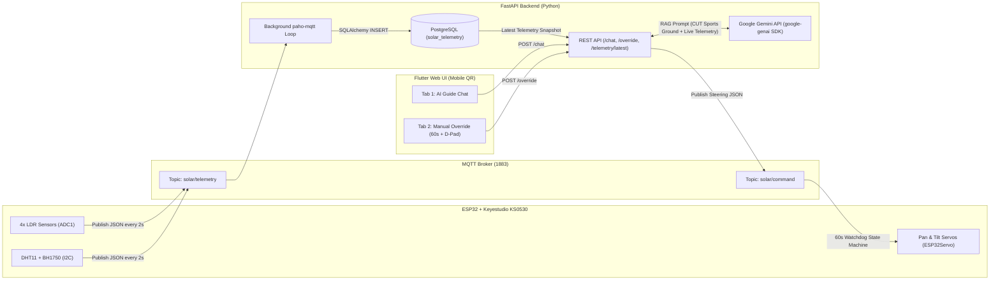

# Central University of Technology (CUT) — Smart Solar Tracking System

Full-stack IoT software stack for the **Central University of Technology (CUT)** smart solar tracking demonstration unit. The system pairs an **ESP32-driven Keyestudio KS0530 Dual-Axis Solar Tracking Kit** with an **MQTT telemetry pipeline**, a **FastAPI + PostgreSQL + Google Gemini (`google-genai`) backend**, and a **mobile-first Flutter Web UI** accessed via QR code.

---

## 1. System Architecture



---

## 2. Monorepo Directory Structure

```text
CUT-solar-tracker/
├── backend/
│   ├── .env.example          # Environment variable template
│   ├── database.py           # SQLAlchemy PostgreSQL engine & session factory
│   ├── main.py               # FastAPI server, lifespan MQTT loop, /chat & /override
│   ├── models.py             # SQLAlchemy SolarTelemetry table & TrackerMode enum
│   ├── mqtt_client.py        # Background paho-mqtt subscriber & command publisher
│   ├── requirements.txt      # Python dependencies
│   └── schemas.py            # Pydantic v2 request/response validation schemas
├── frontend/
│   ├── pubspec.yaml          # Flutter Web dependencies
│   ├── web/
│   │   └── index.html        # Mobile viewport configuration
│   └── lib/
│       ├── main.dart         # Responsive mobile UI (AI Guide & Manual Override tabs)
│       └── services/
│           └── api_service.dart # HTTP client for FastAPI endpoints
├── firmware/
│   ├── platformio.ini        # PlatformIO ESP32 configuration & library dependencies
│   └── src/
│       └── main.cpp          # ESP32 Arduino C++ firmware for Keyestudio KS0530
└── README.md
```

---

## 3. Hardware Pinouts (ESP32 ↔ Keyestudio KS0530)

> **Important ADC Note:** The ESP32 `ADC2` peripheral conflicts with the Wi-Fi radio. All 4 photoresistor (LDR) channels are mapped to **ESP32 `ADC1` pins (`GPIO 32–35`)** so 12-bit analog readings (`0–4095`) operate reliably while Wi-Fi and MQTT are active.

| KS0530 Component | Original Uno Pin | ESP32 Pin | Interface / Protocol | Notes |
| :--- | :--- | :--- | :--- | :--- |
| **LDR Top-Left (`lt`)** | `A0` | `GPIO 34` | `ADC1_CH6` (Analog Input) | 12-bit ADC (`0–4095`), input-only pin |
| **LDR Top-Right (`rt`)** | `A1` | `GPIO 35` | `ADC1_CH7` (Analog Input) | 12-bit ADC (`0–4095`), input-only pin |
| **LDR Bottom-Left (`ld`)** | `A2` | `GPIO 32` | `ADC1_CH4` (Analog Input) | 12-bit ADC (`0–4095`) |
| **LDR Bottom-Right (`rd`)** | `A3` | `GPIO 33` | `ADC1_CH5` (Analog Input) | 12-bit ADC (`0–4095`) |
| **Horizontal Servo (Pan / Azimuth)** | `D9` | `GPIO 18` | 50 Hz PWM (`ESP32Servo`) | `500–2400 µs` pulse width (`5°–175°`) |
| **Vertical Servo (Tilt / Elevation)** | `D10` | `GPIO 19` | 50 Hz PWM (`ESP32Servo`) | `500–2400 µs` pulse width (`15°–165°`) |
| **DHT11 Temp & Humidity** | `D7` | `GPIO 4` | Single-Bus Digital | Ambient temperature (°C) & relative humidity (%) |
| **BH1750 Light Intensity** | `A4 (SDA)` / `A5 (SCL)` | `GPIO 21 (SDA)` / `GPIO 22 (SCL)` | Hardware I2C (`0x23`) | Illuminance in Lux (`lx`) |

---

## 4. API Endpoints & MQTT Contracts

### REST API Endpoints (`FastAPI`)

| Method | Endpoint | Description | Request Body | Response Body |
| :--- | :--- | :--- | :--- | :--- |
| `GET` | `/telemetry/latest` | Fetches the latest sensor & servo state from PostgreSQL. | *None* | `TelemetryPayload` JSON object |
| `POST` | `/chat` | Queries the Google Gemini AI Guide (`google-genai` SDK) with RAG system prompt injection referencing the CUT university sports ground solar arrays and live telemetry. | `{"query": "How does this relate to the CUT sports ground panels?"}` | `{"reply": "...", "latest_telemetry": {...}}` |
| `POST` | `/override` | Publishes a manual control or directional D-pad command to MQTT `solar/command`. | `{"action": "TAKE_CONTROL" \| "UP" \| "DOWN" \| "LEFT" \| "RIGHT" \| "RELEASE", "step": 5}` | `{"status": "published", "topic": "solar/command", "published_payload": {...}}` |

### MQTT Topics

1. **`solar/telemetry` (ESP32 → FastAPI, published every 2 seconds):**
   ```json
   {
     "ldr_top_left": 2840,
     "ldr_top_right": 2795,
     "ldr_bottom_left": 2110,
     "ldr_bottom_right": 2090,
     "servo_pan": 95,
     "servo_tilt": 110,
     "temperature": 26.4,
     "humidity": 42.0,
     "lux": 845.5,
     "current_mode": "AUTO"
   }
   ```
2. **`solar/command` (FastAPI → ESP32, published on `/override` calls):**
   ```json
   {
     "mode": "MANUAL",
     "action": "UP",
     "step": 5
   }
   ```
   - Receiving `TAKE_CONTROL`, `UP`, `DOWN`, `LEFT`, or `RIGHT` switches the ESP32 state machine to `MANUAL` mode, halts LDR tracking, adjusts the target servo angle, and resets the **60-second hardware watchdog timer**.
   - If 60 seconds pass without a new MQTT command on `solar/command`, the ESP32 automatically transitions back to `AUTO` mode.

---

## 5. Setup & Running Instructions

### A. FastAPI Backend (`backend/`)
```bash
cd backend
python -m venv .venv
# Windows PowerShell:
.\.venv\Scripts\Activate.ps1
pip install -r requirements.txt

cp .env.example .env
# Edit .env with your PostgreSQL DATABASE_URL, MQTT_BROKER, and GEMINI_API_KEY
uvicorn main:app --host 0.0.0.0 --port 8000 --reload
```

### B. Flutter Web Frontend (`frontend/`)
```bash
cd frontend
flutter pub get
flutter run -d web-server --web-port 3000 --dart-define=API_BASE_URL=http://localhost:8000
```

### C. ESP32 Firmware (`firmware/`)
1. Update `WIFI_SSID`, `WIFI_PASSWORD`, and `MQTT_BROKER` at the top of `firmware/src/main.cpp`.
2. Build and flash with PlatformIO:
   ```bash
   cd firmware
   pio run --target upload
   pio device monitor
   ```
